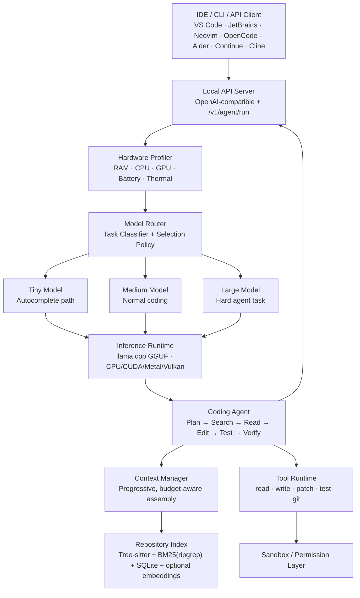
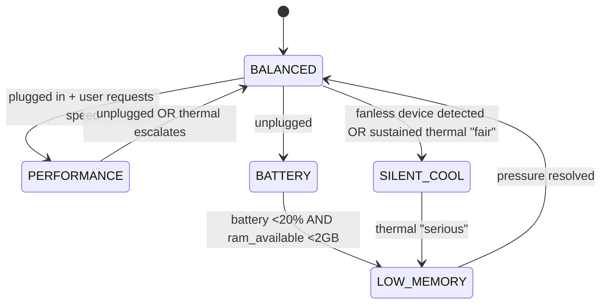

# Hardware-Aware Local Coding Agent — Technical Architecture Specification

**Status:** Draft v1 · **Scope:** Architecture + interfaces + implementation roadmap
**Non-goal of this document:** picking final models (see the model-research pass) or writing production code — this defines the contracts everything else is built against.

---

## 1. Design Philosophy

The platform's job is to keep one policy question separate from every component: *"given this machine, right now, what is the best coding assistance we can deliver without hurting the machine?"* Every layer below takes the hardware profile as an input, not a constant.

**Optimization target.** Replace "maximum tokens/sec" with:

```
CTE_task    = success(task) / (peak_RAM_GB × energy_joules)
CTE_session = Σ success(task) / (avg_RAM_GB × total_energy_joules × total_wall_seconds)
```

One correction to the original formula: **RAM shouldn't sit undifferentiated in the denominator.** RAM is a *capacity*, not a *consumable* — a model that reserves 8GB but leaves the machine responsive isn't automatically worse than one using 4GB, unless that 8GB is actually needed by something else (the OS, the IDE, other apps). What actually matters is **RAM pressure** (did the user notice swapping, spinner-of-death, thermal throttling?) more than raw GB reserved. Recommend measuring `CTE` with *peak RSS relative to available-at-launch RAM* rather than absolute GB, so an 8GB-min-spec model isn't penalized on a 64GB workstation. Track both; decide during Phase 6 benchmarking which correlates better with real user-perceived quality.

**Non-goals:**
- One model for every machine.
- Training a foundation model from scratch.
- Maximum raw throughput regardless of heat/battery/RAM pressure.
- Automatically enabling every optimization technique (MoE, speculative decoding, embeddings) — each earns its place only via the Phase 6 benchmark gate.

---

## 2. System Architecture



**Three concrete request flows** through this diagram:

1. **Autocomplete** (keystroke): Client → API `/v1/completions` (FIM) → Router (fast path, skips full classifier: this endpoint *is* the classification) → Tiny model, small fixed context, no tool loop, no agent → stream tokens back. Target latency: <200ms to first token.
2. **Normal coding chat** ("write a function that..."): Client → `/v1/chat/completions` → Router classifies `NORMAL_CODING` → Medium model + Context Manager (Stage 1–3: current file, function, related symbols) → single-shot or short tool loop → response.
3. **Hard agent task** ("refactor auth across the repo"): Client → `/v1/agent/run` (SSE) → Router classifies `HARD_AGENT` → Large model (or largest that fits) → full Plan→Act→Test loop with Context Manager Stage 1–6 and repeated tool calls → streamed plan/tool/observation events → final diff.

---

## 3. Component Specifications

### 3.1 Hardware Profiler

**Responsibilities:** sample RAM/CPU/GPU/battery/thermal state; expose a stable schema regardless of OS; fire events on state changes (plug/unplug, thermal escalation, low-battery).

**Detection per platform:**
| Platform | RAM/CPU | GPU | Battery/Thermal |
|---|---|---|---|
| Linux | `/proc/meminfo`, `/proc/stat` | `nvidia-smi` / `rocm-smi` if present | `/sys/class/power_supply`, `/sys/class/thermal` |
| Windows | WMI (`Win32_OperatingSystem`) | NVML / DXGI | WMI battery + thermal zones (best-effort) |
| macOS | `sysctl`, `host_statistics` | Metal device query (core count, unified memory) | `IOKit` power sources, `powermetrics` (needs elevated perms — degrade gracefully) |

**Output schema** (polled every 5–10s + event-triggered):

```json
{
  "ram_total_gb": 16.0,
  "ram_available_gb": 9.2,
  "cpu": { "cores": 8, "arch": "arm64", "isa": ["neon"] },
  "gpu": { "backend": "metal", "cores": 10, "unified_memory": true, "vram_gb": null },
  "battery": { "present": true, "on_ac": false, "percent": 62 },
  "thermal_state": "nominal",
  "power_mode": "balanced",
  "timestamp": "2026-09-21T10:00:00Z"
}
```
`thermal_state` ∈ `{nominal, fair, serious, critical}` — mapped from each OS's native scale where one exists (macOS thermal pressure notifications), estimated from sustained CPU% + duration elsewhere.

### 3.2 Model Router

Two stages, kept separate so the classifier can be swapped or upgraded without touching selection policy.

**Stage A — Task Classifier.** Start with *heuristics only* for v0 — don't spend RAM on a dedicated classifier model until heuristics prove insufficient:
- Request hit `/v1/completions` (FIM) → `AUTOCOMPLETE`
- Chat message with no repo-wide language, <50 tokens, single-file context → `CHAT_SIMPLE`
- Chat message referencing multiple files, a stack trace, or "refactor/across/architecture" → `HARD_AGENT`
- Everything else → `NORMAL_CODING`
- Explicit `/review` command → `CODE_REVIEW`

**Stage B — Selection Policy.** Pure function: `(task_class, hw_profile, user_power_mode) → RoutingDecision`.

```typescript
interface RoutingDecision {
  model_id: string;
  quant: "Q4_K_M" | "Q5_K_M" | "Q6_K" | "Q8_0" | "mxfp4";
  ctx_window: number;
  kv_cache_budget_mb: number;
  max_output_tokens: number;
  gpu_layers: number | "auto";
}
```

**Model manager / hot-swap contract:** the Router never loads models directly — it asks a `ModelManager` singleton:

```typescript
interface ModelManager {
  ensure(decision: RoutingDecision): Promise<LoadedModel>; // loads if not resident, evicts LRU if RAM budget exceeded
  unload(model_id: string): void;
  resident(): LoadedModel[];
}
```
On ≤16GB systems, `ModelManager` caps resident models to 1 (except a tiny always-resident autocomplete model, if budget allows). On 32GB+, allow 2 resident (autocomplete + one coding model) to avoid reload latency on every keystroke-vs-chat switch.

### 3.3 Inference Runtime

**Decision:** standardize on **llama.cpp / GGUF** as the one supported backend for v1. It's the only runtime with mature CPU + CUDA + Metal + Vulkan + ROCm support, which matters more here than squeezing out the last 10-15% Apple Silicon speed MLX sometimes offers. Add an MLX backend only if Phase 6 benchmarks show a large enough Apple Silicon gap to justify maintaining two runtimes — don't commit to it up front.

```typescript
interface InferenceBackend {
  load(modelPath: string, cfg: LoadConfig): Promise<void>;
  generate(prompt: Prompt, params: GenParams): AsyncIterable<Token>;
  unload(): void;
  capabilities(): { maxContext: number; supportsGpuOffload: boolean; kvQuant: string[] };
}
```
KV-cache quantization (`kv_cache_dtype: q4_0 | q8_0 | f16`) and `gpu_layers` are exposed as first-class config, computed by the Router from the memory budget math in §2 of the research pass, not hard-coded.

**Speculative decoding:** implement behind a feature flag (`spec_decode: draft_model_id | null`), off by default. Ship only after a Phase 6 A/B shows a real tokens/sec *and* tokens/joule improvement on at least two of the three reference machines — otherwise rip it out per the original spec's own instruction.

### 3.4 Context Manager

Progressive assembly, budget-capped, stops as soon as the budget for the current tier is hit:

```typescript
interface ContextBundle {
  files: { path: string; snippet: string; why: string }[];
  symbols: SymbolRef[];
  budget_tokens_used: number;
  budget_tokens_max: number;
  stage_reached: 1 | 2 | 3 | 4 | 5 | 6;
}
```
Stage 1 (current file) → 2 (relevant function/class) → 3 (related symbols) → 4 (imports/deps) → 5 (tests) → 6 (related repo files). The manager is called with a token budget derived from `ctx_window - reserved_for_output - reserved_for_system_prompt`; it stops climbing stages once the budget is spent, so it's naturally cheaper on 8GB (small budget → stops at Stage 2–3 most of the time) without any special-casing.

### 3.5 Repository Intelligence / Index

- **Structure:** Tree-sitter for AST + symbol table, stored in SQLite; ripgrep-backed BM25 for text search; embeddings are *optional* and loaded only on demand (small local embedding model, unloaded immediately after indexing — never resident alongside the coding model on ≤16GB).
- **Indexing policy:** event-driven only. File-watcher → diff → re-index only the changed file's symbols/embeddings. No polling, no continuous background scan (per original spec §30).
- **Interface:** `IndexStore.query(query: string, kind: "symbol"|"text"|"semantic", k: number): SearchResult[]` — semantic queries return empty/degrade gracefully if the embedding model hasn't been loaded for this session.

### 3.6 Coding Agent

State machine, not a single long prompt:

```
PLAN → SEARCH → READ → REASON → EDIT → TEST → OBSERVE → (FIX → TEST → OBSERVE)* → VERIFY
```
Bounded by `max_tool_calls` and `max_wall_seconds`, both derived from the power mode (BATTERY/SILENT modes cap agent loops tighter than PERFORMANCE). Editing always attempts the precision ladder before falling back:

`AST edit → symbol edit → patch (unified diff) → targeted replacement → full-file rewrite (last resort, logged as such)`

`AgentState` is serializable (for `/compact`, `/undo`, and crash recovery) — every step appends an event; `/undo` pops the last applied edit event and reverts via the diff, not by re-generating.

### 3.7 Tool Runtime

OpenAI-compatible function-calling schemas. Every tool returns a **compact** result — enforced at the runtime layer, not left to model discipline:

```typescript
interface ToolResult {
  ok: boolean;
  data: unknown;       // e.g. {file, line, symbol, snippet} not a whole file
  truncated: boolean;
  size_bytes: number;  // runtime hard-caps this (e.g. 4KB) and sets truncated=true past it
}
```
Tool set: `read_file, write_file, apply_patch, search, find_symbol, list_files, run_tests, run_linter, run_formatter, run_build, git_status, git_diff, git_log`.

**Sandbox boundary:** workspace-root jail (no path traversal outside repo root without explicit user confirmation), a command allowlist for `run_build`/`run_tests` (no arbitrary shell), network egress denied by default, and a hard denylist on reads of `.env`, `.ssh/`, cloud credential paths, and OS keychains — enforced at the tool layer, invisible to and non-overridable by the model.

### 3.8 Local API Server

- `POST /v1/chat/completions` — OpenAI-compatible, streaming supported
- `POST /v1/completions` — fill-in-middle, the autocomplete fast path
- `GET /v1/models` — lists currently *available* (not necessarily loaded) models per the tier matrix
- `POST /v1/agent/run` — SSE stream of `{type: "plan"|"tool_call"|"tool_result"|"observation"|"diff"|"done", ...}` events, for IDEs that want to render agent progress live
- `GET /v1/resource` — current `HardwareProfile` + `RoutingDecision`, so an IDE status bar can show "Qwen2.5-Coder-14B · Q4 · BALANCED · 6.1GB/16GB"

Bound to `localhost` by default; optional bearer token for LAN use (e.g. a headless workstation serving a laptop over the network).

### 3.9 IDE / Client Integration Layer

Because §3.8 is OpenAI-compatible, **Aider, Continue, Cline, and OpenCode need configuration, not custom code** — point their "custom OpenAI endpoint" setting at `localhost:<port>`. Build a genuinely custom integration only where there's no existing OpenAI-compatible plugin path: a thin VS Code extension for the agent SSE stream (progress UI, diff review, `/undo`) and, if demand justifies it, a JetBrains plugin later.

---

## 4. Model Tier Matrix

Reflects current (Sept 2026) research — **re-verify before each release**, this list moves monthly.

| Hardware | Primary candidate(s) | Total / Active params | Quant footprint | Notes |
|---|---|---|---|---|
| 8 GB | Phi-4-mini (3.8B) or Qwen3.5-4B | dense | ~2.5–3GB Q4 | MoE gives no benefit here — storage floor is the constraint, not compute |
| 16 GB | Qwen2.5-Coder-14B; gpt-oss-20b | 14B dense / 21B–3.6B active MoE | ~9GB / ~12–14GB | gpt-oss-20b is the first tier where MoE's compute savings start to matter |
| 24–32 GB | Devstral Small 2 (24B); Qwen3-Coder-30B-A3B; GLM-4.7-Flash | 24B dense / 30B–3.3B active / 30B–3.6B active | ~13GB / ~19GB / ~24GB | Devstral is dense (simpler memory math); the two MoEs trade some RAM for faster generation |
| 64 GB+ | Qwen3-Coder-Next (80B–3B active) | MoE | ~46GB Q4 | Proof that "active params" ≠ "RAM needed" — don't market this as an 8GB-class model |

Autocomplete-tier and normal/agent-tier models are selected independently per machine — an 8GB machine's "tiny" and "medium" model may be the *same* model at different context/quant settings, since there's no room for two resident models.

---

## 5. Power & Thermal State Machine



Each escalation applies the downgrade ladder in order, stopping as soon as the target is met — never jump straight to "swap to smaller model" if trimming threads is enough:

`reduce CPU threads → reduce GPU offload layers → reduce max generation tokens/sec (throttle) → shrink context window → swap to smaller model tier → pause background indexing`

`SILENT_COOL` is the default (not opt-in) on any device flagged fanless (MacBook Air family) or on any device where a thermal sensor isn't available at all (safe default = assume constrained).

---

## 6. Distillation Pipeline (Teacher → Student)

```
Teacher ensemble (DeepSeek V4 / Qwen3-Coder-480B / GLM-5.3 / Kimi K3)
        │
        ▼
Trajectory generation (task + fix + test trajectories, per original spec §6–7)
        │
        ▼
Verification gate — compile, run tests, lint, type-check (reject on any failure)
        │
        ▼
Rights-review gate  ← NEW, mandatory, blocks the pipeline
        │
        ▼
Filtered, licensed dataset
        │
        ▼
Student fine-tune (per-capability: completion, editing, bug-fixing, tool-calling, measured independently)
        │
        ▼
Quantize (Q4/Q5/Q6) → Benchmark gate (must match or exceed a same-size non-distilled baseline) → Ship
```

**Rights-review gate, made concrete:** before any distilled dataset or resulting model is redistributed, confirm (a) each teacher model's license permits generating and redistributing training data from its outputs — most open-weight licenses (Apache 2.0, MIT) are fine here, but verify per-model since terms do change, and (b) no teacher output reproduces third-party copyrighted code verbatim (run a code-clone/near-duplicate detector against public corpora as part of the verification gate, not just tests/lint). This is a legal review step, not an engineering one — flag it early since it can block a release regardless of technical quality.

---

## 7. Security & Sandboxing

Restates original §34 as enforceable contracts, not guidelines: workspace jail + command allowlist + secret denylist (§3.7) are implemented in the Tool Runtime layer, meaning even a fully "jailbroken" prompt can't reach outside them — this is a code boundary, not a prompt instruction.

---

## 8. Implementation Roadmap

| Phase | Goal | Exit criteria | Key risk |
|---|---|---|---|
| **0 — Foundations** | Inference runtime wrapper (llama.cpp), API server skeleton, CLI skeleton, Hardware Profiler v0 | `localcoder serve` answers `/v1/chat/completions` on all 3 reference OSes | GGUF/Metal build friction on macOS |
| **1 — Repository Intelligence** | Indexer (Tree-sitter + BM25 + SQLite), Context Manager Stages 1–4 | Correct symbol lookup on a 50k-line reference repo, event-driven re-index <500ms | Tree-sitter grammar coverage across languages |
| **2 — Agent Core** | Tool Runtime + sandbox, Plan→Act→Test loop, precision-edit ladder | Agent fixes a seeded bug end-to-end with passing tests, sandbox blocks an escape attempt in a red-team test | Over-broad tool permissions |
| **3 — Router & Adaptive Runtime** | Task classifier (heuristic), tier matrix wiring, power/thermal state machine, hot-swap ModelManager | Same binary runs usably on an 8GB VM and a 64GB workstation without config changes | Heuristic classifier misroutes; revisit before adding a trained classifier |
| **4 — IDE Integration** | VS Code extension (agent SSE + diff review), verified compatibility with Aider/Continue/Cline via OpenAI endpoint | A real coding session completed entirely through the extension | SSE event schema churn breaking early integrators |
| **5 — Distillation Pipeline** | Trajectory generation + verification + rights-review harness, first student model shipped | Student ≥ same-size baseline on the benchmark matrix (§9) | Data quality/rights review taking longer than training |
| **6 — Benchmark Matrix & Auto-tuning** | First-run benchmark, `doctor` command, CTE measurement harness across reference hardware | Auto-tuning picks a config within 10% of manually-tuned optimum | Access to real 8GB/M1/M-series hardware for *measured* (not estimated) numbers |

Phases 0–2 can run in parallel by different people; Phase 3 depends on all of them; Phase 5 can start its data pipeline early but shouldn't block on Phase 4.

---

## 9. Benchmarking Plan

Matrix dimensions: model × quant × RAM tier × context size → tokens/sec, tokens/joule, latency-to-first-token, coding accuracy (repo-level, not just HumanEval), tool-call accuracy, patch success rate, thermal delta over a 10-minute and 30-minute sustained agent task.

**Labeling discipline (non-negotiable):** every number in the benchmark report is tagged `measured` (ran on the listed physical hardware), `estimated` (extrapolated from a similar SKU), or `theoretical` (spec-sheet math, not run). Never present `estimated` or `theoretical` as `measured`.

---

## 10. Open Questions Before Phase 0

1. Genuinely-8GB targets: confirm whether *any* MoE model clears the storage floor at 8GB, or whether that tier stays 100% dense models (research so far says the latter).
2. Heuristic vs. trained task classifier — ship heuristic first, define the specific misroute rate that would justify training one.
3. Speculative decoding — go/no-go is a Phase 6 benchmark result, not a Phase 0 commitment.
4. Embedding model choice for optional semantic retrieval, and the exact trigger for when BM25-only isn't enough.
5. Chain-of-custody documentation format for the distillation rights-review gate — needs a template before Phase 5, not during it.
