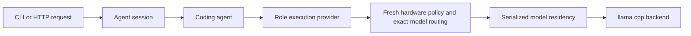
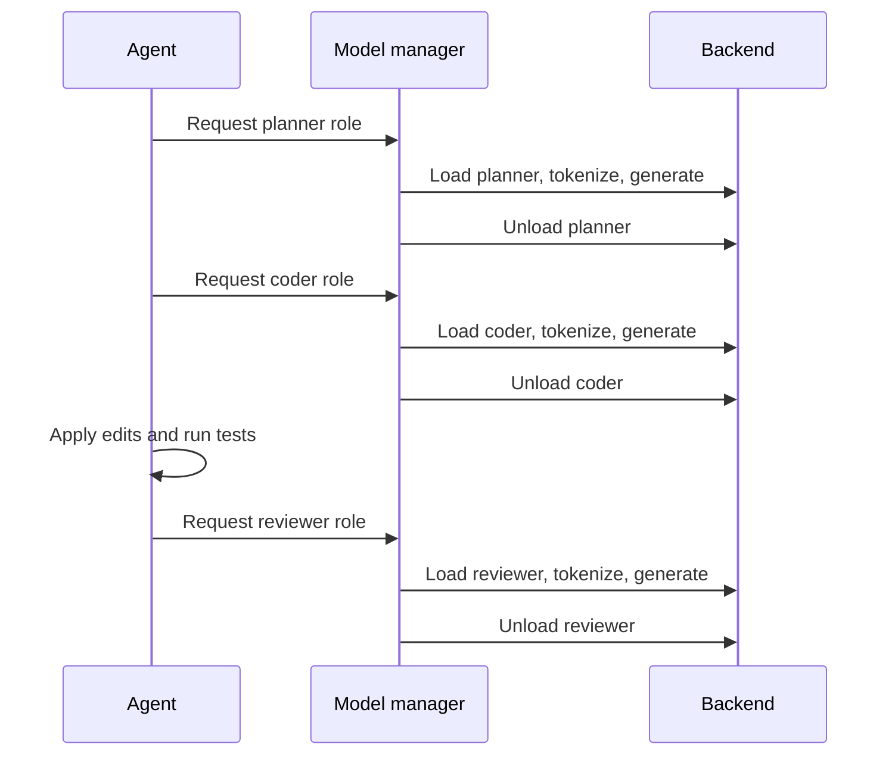
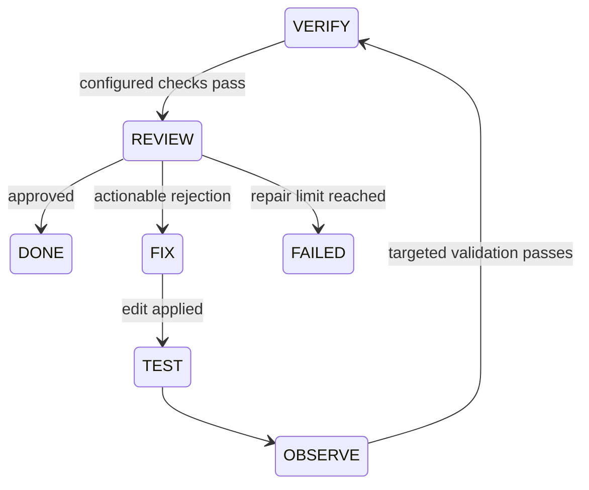

# Sequential Model Workflow - Plan

## Goal Capsule

Users can complete one coding task with planner, coder, and reviewer models while keeping one model loaded at a time. The CLI and HTTP agent entry points expose the same behavior.

Implementation continues in the current checkout on main, with separate commits and pushes for complete implementation units, as the user requested. Stop only for a technical prerequisite that cannot be satisfied within the task. Existing single-model tasks remain usable.

## Product Contract

### Summary

Add an optional three-role workflow configured in the workspace agent configuration. A planner prepares the task, a coder edits and repairs the implementation, and a reviewer checks the result after validation. Compact task state connects the roles.

### Problem Frame

The agent currently pins one backend and one tokenizer to the whole task. Residency tests exercise switching between requests, while a single task cannot request specialist models. The outer HTTP lease also prevents a second backend from replacing the current model.

### Requirements

- R1. A configured workflow uses planner, coder, and reviewer model IDs in one task and allows at most one model resident during each role call.
- R2. Each role must pass the real routing memory gate and use its own context window, output allowance, and tokenizer.
- R3. Every successful workflow completion requires validated reviewer approval after all available configured tests pass.
- R4. Reviewer rejection supplies actionable feedback to the existing bounded coder repair loop.
- R5. Cancellation, load failures, malformed model responses, and rejected resource budgets release model resources and retain honest failure or resumable outcomes.
- R6. Saved workflow tasks retain their role assignments and review state across resume, including resuming an interrupted review.
- R7. Workspaces without role configuration retain the existing single-model behavior and existing saved tasks remain readable.
- R8. CLI output and HTTP events identify the role and selected model, and documentation explains configuration and verification limits.

### Scope Boundaries

The user selected sequential role collaboration over investigating disk-backed models larger than available RAM. Selective tensor loading and a custom inference engine are outside this change. Trained-model quality is reported only when a trained model was actually exercised.

## Planning Contract

### Key Technical Decisions

- KTD1. Add an optional models mapping with all three role IDs to the existing workspace agent configuration. Resolve new tasks from configuration and resumed tasks from saved assignments. This implements R6 and R7.
- KTD2. Add a manager operation that owns serialized residency through role-specific tokenization and generation, and unloads the backend before releasing that operation. Existing HTTP acquisitions wait for it. This implements R1 and R5 without changing resource-policy values.
- KTD3. Acquire the role before constructing and fitting its prompt. Build repository context using the existing compact-context machinery, then fit against the active backend tokenizer and actual routing decision. This implements R2.
- KTD4. Route successful verification into a REVIEW state for configured workflows. Review produces approval, findings, and a short summary. Rejection enters FIX, and approval completes the task. Only the coder can propose file edits. This implements R3 and R4.
- KTD5. Preserve existing agent constructors and test seams with an optional model execution provider. Workflow sessions use that provider and avoid holding a legacy model lease over the run. This implements R5 and R7.

### High-Level Technical Design

The sketches describe relationships and sequencing, and leave exact method names to implementation.

### Execution Assumptions

Role configuration is opt-in. Assigning the same registered model to several roles is supported. Overall wall-clock, tool-call, and repair limits stay tied to the run-start policy. The user has authorized implementation and individual pushes to main.

## Implementation Units

### U1. Execute roles with exclusive model residency

Goal is to acquire, budget, use, and release one role backend safely. Covers R1, R2, and R5 through KTD2 and KTD3.

Files include src/manager/model-manager.ts, src/agent/model-workflow.ts, shared model-role types, and focused manager/workflow tests. Start with failing tests for role replacement, waiting active requests, concurrent ordinary acquisitions, tokenization before generation, and cleanup after rejection, failure, and cancellation.

Verification requires real entry-point coverage of a complete serialized lifecycle, including same-ID configuration differences and every backend unloaded after failure.

### U2. Integrate planning, coding, review, and resume

Depends on U1. Covers R3 through R7 using KTD1, KTD4, and KTD5.

Files include agent configuration, coding-agent, state, session, preflight, CLI agent command, server agent route, and existing agent tests. Start with deterministic regressions for plan → edit → test → review, reviewer rejection followed by coder repair, no-change review, failed tests preventing approval, malformed review responses, cancellation while queued, and review resume.

Verification requires the legacy agent tests to pass and both CLI and HTTP entry points to execute the configured workflow. Persisted states created before the feature must remain readable.

### U3. Verify real engine switching and publish usage

Depends on U2. Covers R1, R2, R5, and R8.

Files include inference integration tests, a focused workflow verification command or report where existing verification can be extended cleanly, README.md, docs/USAGE.md, and docs/VERIFICATION.md. Exercise real llama.cpp model processes sequentially, observe process cleanup, and report model load times and measured resident memory. Use trained models for quality claims and label random-weight fixtures explicitly.

## Verification Contract

Run focused regression tests for each unit, then npm run typecheck, npm run build, and the complete npm test suite. Run an independent code review before completion and fix retained findings. Exercise a real server or CLI workflow, inspect generated files and actual configured test results, and record peak simultaneously resident models. Live resource gates remain active during user-facing verification.

## Definition of Done

All configured roles run through the normal agent entry points, reviewer feedback can trigger bounded repairs, cancellation releases every backend, and regression coverage includes existing and resumed tasks. The working tree is clean after individual commits and pushes. The verification record states which real model runs succeeded and which quality or platform checks remain unverified.
