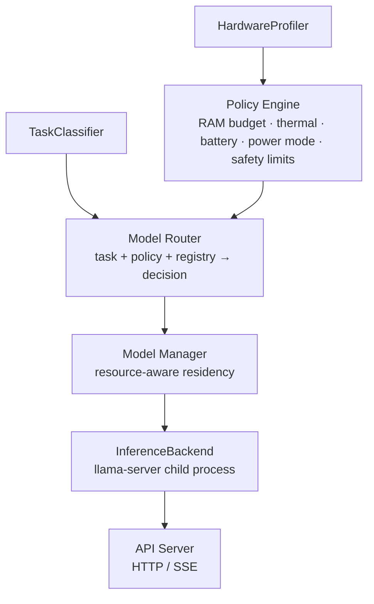

# localcoder — Implementation Specification (v0 Contract)

**Purpose:** this document is the thing an implementer opens with no other context and starts writing code against. It supersedes `architecture-spec.md` for anything the two disagree on — this one has the corrections applied. Every interface below is considered **locked** for Phase 0; changing one requires updating this doc first, not discovering the change in a PR.

**Runtime decision (needs stating up front):** orchestration (CLI, API server, Router, Policy Engine, Model Manager) is TypeScript on Node.js. Inference itself runs as **`llama-server` child processes, one per resident model**, managed and proxied by `ModelManager` — not a native binding. Trade-off, stated plainly: a native binding (e.g. node-llama-cpp) gives finer per-request control over KV-cache params; the process-per-model approach gives free CUDA/Metal/Vulkan support maintained upstream, process-level crash isolation, and zero binding-maintenance burden. For a v0 that needs to run correctly on three OSes before it needs to be maximally tunable, that trade favors the subprocess approach. Revisit if Phase 6 profiling shows the IPC hop actually costs something measurable.

---

## 1. Updated Architecture — Policy Engine Inserted



`PolicyEngine` answers *"what is this machine capable of right now"* independent of any request. `TaskClassifier` and `ModelRouter` answer *"what does this specific request need."* Neither reaches around the other — the Router never reads raw `HardwareProfile`, only the `ResourcePolicy` the Policy Engine derived from it.

---

## 2. Locked Core Contracts

All types live in `src/types/` as the single source of truth — no component redefines its neighbor's shape locally.

### 2.1 Hardware Profiler

```typescript
interface HardwareProfile {
  ram_total_gb: number;
  ram_available_gb: number;          // OS-reported free memory
  memory_budget_gb: number;          // NEW — safely allocatable, see formula below
  ram_pressure: "low" | "medium" | "high";
  cpu: { cores: number; arch: "x86_64" | "arm64"; isa: string[] };
  gpu: { backend: "metal" | "cuda" | "vulkan" | "cpu"; cores?: number; vram_gb?: number; unified_memory: boolean };
  battery: { present: boolean; on_ac: boolean; percent?: number };
  thermal_state: "nominal" | "fair" | "serious" | "critical" | "unknown";
  thermal_confidence: "high" | "medium" | "low";   // NEW — see §2.2 rule
  timestamp: string;
}

interface HardwareProfiler {
  sample(): Promise<HardwareProfile>;
  onChange(cb: (p: HardwareProfile) => void): () => void; // returns unsubscribe
}
```

**`memory_budget_gb` formula** (Phase 0 defaults, tune once real hardware numbers come in during Phase 6):

```
memory_budget_gb = ram_available_gb - os_reserve_gb(platform) - safety_margin_gb
os_reserve_gb: linux=1.0, windows=1.5, macos=2.0   (macOS reserves more: unified memory is shared with WindowServer/GPU)
safety_margin_gb: 0.5 (all platforms, Phase 0 constant)
```
The Router reads **`memory_budget_gb` only** — `ram_available_gb` is diagnostic/display data (shown in `/v1/resource` and `doctor`), never a value anything allocates against.

### 2.2 Thermal Confidence Rule

CPU utilization is not a temperature. Where no OS thermal sensor is reachable:

```
thermal_state = "unknown"
thermal_confidence = "low"
```

`PolicyEngine` treats `thermal_state == "unknown"` **as `"fair"`** for policy purposes — conservative by default, never assumed safe. This is a unit-testable rule (AT-0.6 below), not a comment.

### 2.3 Policy Engine (new component)

```typescript
interface ResourcePolicy {
  power_mode: "performance" | "balanced" | "battery" | "silent_cool" | "low_memory";
  memory_budget_gb: number;
  max_context_tokens: number;
  max_gpu_offload_fraction: number;   // 0..1, portable — see §2.5 on why not gpu_layers
  max_agent_wall_seconds: number;
  max_tool_calls: number;
  allow_background_indexing: boolean;
}

interface PolicyEngine {
  derive(profile: HardwareProfile, userOverride?: Partial<ResourcePolicy>): ResourcePolicy;
}
```

### 2.4 Task Classifier

```typescript
type TaskClass = "autocomplete" | "chat_simple" | "normal_coding" | "hard_agent" | "code_review";

interface TaskClassifier {
  classify(request: IncomingRequest): TaskClass;
}
```
Phase 0 implementation is pure heuristic (endpoint hit + message shape) — no model, no training data, per the original plan. A request to `/v1/completions` never reaches the classifier at all (see §2.7, isolation rule).

### 2.5 Model Registry, Router, Manager

```typescript
interface ModelRegistryEntry {
  model_id: string;
  architecture: "dense" | "moe";
  parameter_count: { total: number; active?: number };
  quantization: "Q4_K_M" | "Q5_K_M" | "Q6_K" | "Q8_0" | "mxfp4";
  file_path: string;
  context_limit: number;
  backend_requirements: ("cpu" | "cuda" | "metal" | "vulkan")[];
  estimated_memory_gb: number;
  capabilities: ("fim" | "tool_calling" | "long_context")[];
}
```
Phase 0's registry is a static `registry/models.json` array of these — no dynamic discovery yet.

```typescript
interface RoutingDecision {
  model_id: string;
  ctx_window: number;
  kv_cache_budget_mb: number;
  kv_cache_dtype: "f16" | "q8_0" | "q4_0";
  max_output_tokens: number;
  gpu_offload_fraction: number;   // portable across backends; see normalization note
}

interface RouterRejection {
  rejected: true;
  reason: "no_model_fits_budget" | "no_model_for_task";
  attempted: { model_id: string; required_gb: number; budget_gb: number }[];
}

interface ModelRouter {
  route(task: TaskClass, policy: ResourcePolicy, registry: ModelRegistryEntry[]): RoutingDecision | RouterRejection;
}
```

`gpu_offload_fraction` (not `gpu_layers`) is the wire-level contract because layer count isn't portable across backends or even across quantizations of the same model. `InferenceBackend.load()` is the **only** place a fraction gets converted to a concrete `--n-gpu-layers` value, using that specific GGUF's known layer count.

**Hard memory-safety gate — the Router must call this before ever returning a decision:**

```typescript
function fitsMemoryBudget(entry: ModelRegistryEntry, decision: RoutingDecision, policy: ResourcePolicy): boolean {
  const kv_gb = decision.kv_cache_budget_mb / 1024;
  const runtime_overhead_gb = 0.5;   // measured default; replace with real number after Phase 0 hardware runs
  const safety_margin_gb = 0.5;
  return entry.estimated_memory_gb + kv_gb + runtime_overhead_gb + safety_margin_gb <= policy.memory_budget_gb;
}
```
If this fails for every candidate model, the Router returns `RouterRejection` — it never loads-and-hopes. The API layer turns that into a clear error response, not a crash or an OOM discovered three requests later.

```typescript
interface LoadedModel {
  model_id: string;
  process_handle: unknown;    // opaque — owns the llama-server child process
  loaded_at: string;
  last_used_at: string;
  priority: number;           // higher = evict later; autocomplete models default higher than agent models
}

interface ModelManager {
  ensure(decision: RoutingDecision, priority?: number): Promise<LoadedModel>;
  unload(model_id: string): Promise<void>;
  resident(): LoadedModel[];
  evictIfNeeded(requiredGb: number, policy: ResourcePolicy): Promise<void>;
}
```
`evictIfNeeded` ranks eviction candidates by `(priority asc, last_used_at asc)` — **not** plain LRU, so a rarely-used-but-cheap-to-reload agent model gets evicted before a frequently-hit autocomplete model even if the agent model was technically touched more recently in wall-clock terms during a long single session.

### 2.6 Inference Backend

```typescript
interface InferenceBackend {
  load(entry: ModelRegistryEntry, decision: RoutingDecision): Promise<void>;
  generate(prompt: PromptPayload, params: GenParams): AsyncIterable<TokenEvent>;
  unload(): Promise<void>;
  tokenize(text: string): number[];      // real tokenizer — see §2.7
  countTokens(text: string): number;
}
interface TokenEvent { token: string; index: number; finish_reason?: "stop" | "length" | "tool_call"; }
```

### 2.7 Context budgeting — real tokenizer, no estimates

Once any component (even Phase 0's minimal chat path) needs to reserve space in a context window, it calls `InferenceBackend.countTokens()` — never `text.length` or a words-based heuristic. This matters starting Phase 0 because `max_output_tokens` reservation in the chat path already depends on it:

```
available_context = ctx_window - system_tokens - conversation_tokens - tool_schema_tokens - output_reserve
```
`tool_schema_tokens` is `0` in Phase 0 (no tools yet) but the field exists in the type now so Phase 2 doesn't have to touch every call site that computes a budget.

### 2.8 Autocomplete isolation (architectural rule, not a suggestion)

```
POST /v1/completions
    → TaskClassifier: bypassed (the endpoint IS the classification)
    → ContextManager: bypassed (fixed small window: cursor ± N lines)
    → IndexStore: bypassed
    → CodingAgent: bypassed
    → ToolRuntime: bypassed
    → straight to Router(task="autocomplete") → ModelManager → InferenceBackend
```
Enforced by import structure (§6), not by convention: `routes/completions.ts` is not permitted to import from `context/`, `index-store/`, `agent/`, or `tools/` at all — the module simply doesn't exist in that file's dependency graph.

### 2.9 Context Manager, Index Store, Tool Runtime, Agent (Phase 1–2 contracts, defined now so Phase 0 types don't need revisiting)

```typescript
interface ContextBundle {
  files: { path: string; snippet: string; why: string; tokens: number }[];
  symbols: SymbolRef[];
  stage_reached: 1|2|3|4|5|6;
  tokens_used: number;
}
interface ContextManager {
  assemble(task: TaskClass, repoIndex: IndexStore, budget: { max_tokens: number }, backend: InferenceBackend): Promise<ContextBundle>;
}

interface SearchResult { path: string; line: number; symbol?: string; snippet: string; score: number; kind: "symbol" | "text" | "semantic"; }
interface IndexStore {
  query(q: string, kind: "symbol" | "text" | "semantic", k: number): Promise<SearchResult[]>;
}

interface ToolResult { ok: boolean; data: unknown; truncated: boolean; size_bytes: number; }
interface ToolRuntime {
  invoke(name: string, args: Record<string, unknown>, sandbox: SandboxContext): Promise<ToolResult>;
  schemas(): JSONSchema[];
}

type AgentEvent =
  | { type: "plan"; content: string }
  | { type: "tool_call"; name: string; args: unknown }
  | { type: "tool_result"; result: ToolResult }
  | { type: "observation"; content: string }
  | { type: "diff"; patch: string }
  | { type: "done"; success: boolean };
interface CodingAgent {
  run(task: string, ctx: ContextBundle, policy: ResourcePolicy): AsyncIterable<AgentEvent>;
}
```

---

## 3. Repo Structure

```
localcoder/
├── package.json  tsconfig.json
├── src/
│   ├── cli/                    { index.ts  serve.ts  doctor.ts  models.ts }
│   ├── server/
│   │   ├── index.ts
│   │   └── routes/             { models.ts  resource.ts  chat.ts  completions.ts }
│   ├── hardware/                { profiler.ts  linux.ts  windows.ts  macos.ts }
│   ├── policy/                  { engine.ts }
│   ├── router/                  { classifier.ts  router.ts  registry.ts }
│   ├── manager/                 { model-manager.ts }
│   ├── inference/                { llama-cpp-backend.ts }
│   ├── context/                  # Phase 1
│   ├── index-store/              # Phase 1
│   ├── tools/                    # Phase 2
│   ├── agent/                    # Phase 2
│   └── types/                    # §2 interfaces, single source of truth
├── schemas/                      # JSON Schemas, §4
├── registry/models.json          # static ModelRegistryEntry[], Phase 0
└── test/
    ├── core/        # §7, one file per AT-0.x
    └── unit/
```

---

## 4. Wire-Level JSON Schemas

Anything crossing an HTTP boundary gets a JSON Schema, generated from the TypeScript types (not hand-duplicated — use `ts-json-schema-generator` or equivalent in the build so the two can't drift). The two Phase 0 response bodies that most need pinning down:

**`GET /v1/resource` response:**
```json
{
  "type": "object",
  "required": ["profile", "policy"],
  "properties": {
    "profile": { "$ref": "#/definitions/HardwareProfile" },
    "policy":  { "$ref": "#/definitions/ResourcePolicy" }
  }
}
```

**`GET /v1/models` response:** array of `ModelRegistryEntry`, plus a `resident: boolean` field merged in from `ModelManager.resident()` at request time — the registry itself doesn't know what's loaded, the route handler joins the two.

---

## 5. Sandbox Enforcement — Honest Status

The original list (filesystem jail, subprocess restrictions, env filtering, network isolation, timeouts, symlink-escape prevention) is right, but stating it plainly: **there is no single clean cross-platform CLI sandboxing primitive.** Linux has namespaces/seccomp/cgroups (real, but need root or user namespaces configured). Windows has Job Objects (solid). macOS's `sandbox-exec` is deprecated with no fully-supported CLI replacement for third-party tools. This is not solved by picking a library — it's a **Phase 2 research spike**, not an assumed-done checkbox. Phase 0/1 ship with the weaker guarantee (workspace-path jail + command allowlist only, no real process-level sandbox) and that limitation is documented in the README, not hidden.

---

## 6. Non-Reach-Around Rules (enforced, not aspirational)

Add as an ESLint import-boundary rule (`eslint-plugin-boundaries` or equivalent), checked in CI:

| From | May import | May NOT import |
|---|---|---|
| `router/` | `types/`, `policy/` (read `ResourcePolicy` only) | `inference/`, `manager/` internals, `tools/` |
| `agent/` | `context/`, `tools/` (via `ToolRuntime` interface only) | filesystem/`fs` directly, `inference/` directly |
| `manager/` | `inference/` | `router/` (Router calls Manager, never the reverse) |
| `context/` | `index-store/`, `inference/` (tokenizer only) | `tools/`, `agent/` |
| `tools/` | `types/` | `router/`, `manager/` (tools never pick a model) |
| `routes/completions.ts` | `router/`, `manager/`, `inference/` | `context/`, `index-store/`, `agent/`, `tools/` (§2.8) |

A PR that violates one of these fails CI on the import-boundary check, not on human review catching it.

---

## 7. Phase 0 — Locked Scope & Acceptance Tests

**In scope:** `HardwareProfiler → PolicyEngine → static ModelRegistry → ModelRouter → ModelManager → llama-server`, plus the four endpoints below.
**Explicitly out of scope:** CodingAgent, IndexStore, ContextManager beyond a fixed-window stub, embeddings, speculative decoding, distillation, any trained classifier.

`localcoder serve` must run on **Linux x86_64, Windows x86_64, macOS arm64** and expose:

- `GET /v1/models`
- `GET /v1/resource`
- `POST /v1/chat/completions`
- `POST /v1/completions`

**Acceptance tests:**

| ID | Test |
|---|---|
| AT-0.1 | `localcoder serve --port 8080` starts on all 3 target OSes; `GET /v1/models` returns the static registry within 2s. |
| AT-0.2 | `GET /v1/resource` returns a schema-valid `{profile, policy}`; `memory_budget_gb < ram_available_gb` strictly, on every sample. |
| AT-0.3 | `POST /v1/chat/completions` with a simple prompt streams an OpenAI-compatible response; measured (not estimated) peak RSS stays ≤ `policy.memory_budget_gb + 0.5GB` safety margin. |
| AT-0.4 | `POST /v1/completions` (FIM) returns first token in <200ms on the reference 16GB machine, and static import analysis confirms `routes/completions.ts` has zero imports from `context/`, `index-store/`, `agent/`, `tools/`. |
| AT-0.5 | With `memory_budget_gb` artificially set below every registry entry's requirement, the Router returns `RouterRejection{reason:"no_model_fits_budget"}` and the API returns a clear error — no crash, no oversized load attempted. |
| AT-0.6 | Unit test: `thermal_state:"unknown"` + `thermal_confidence:"low"` input → `PolicyEngine.derive()` treats it as `"fair"`, verified by asserting the resulting `power_mode`/`max_context_tokens` match the "fair" case, not "nominal". |
| AT-0.7 | On a simulated `memory_budget_gb < 12`, `ModelManager.resident()` never exceeds length 1 after any sequence of requests. |
| AT-0.8 | `localcoder doctor` prints OS, CPU, GPU, RAM, `memory_budget_gb`, `thermal_state`, `thermal_confidence`, selected model, power mode — and exits 0. |

This is a genuinely small vertical slice on purpose: it's the first point where the memory-budget math and the subprocess-per-model approach get tested against real machines, before six more abstractions get built on top of an unverified foundation.

---

## 8. Phase 1–6, Referencing Locked Contracts

| Phase | Adds | New contracts exercised |
|---|---|---|
| 1 — Repo Intelligence | `IndexStore` (Tree-sitter + BM25 + SQLite), `ContextManager` real implementation | §2.9, real `countTokens()` usage in budget math |
| 2 — Agent Core | `ToolRuntime`, `CodingAgent`, sandbox research spike (§5) resolved to at least Phase-1 guarantees | §2.9, `SandboxContext` |
| 3 — Full Router/Runtime | Real `TaskClassifier` evaluation (heuristic misroute rate measured — only then consider training one), power/thermal state machine wired to live sensors | §2.2–2.5 under real hardware load |
| 4 — IDE Integration | VS Code extension consuming `/v1/agent/run` SSE | No new core contracts — proof existing ones are sufficient |
| 5 — Distillation (optional) | Only started if Phase 6 benchmarking shows a measured gap a distilled student would close — **not on the v1 critical path** | N/A — separate pipeline, doesn't touch this contract set |
| 6 — Benchmark Matrix | `measured/estimated/theoretical` labeling enforced in report generation | Validates the `memory_budget_gb` and `runtime_overhead_gb` constants above against real numbers |

---

## 9. What Changed From `architecture-spec.md`

For anyone diffing against the previous doc: added Policy Engine as a distinct component; replaced `ram_available_gb`-as-budget with `memory_budget_gb` + `ram_pressure`; added `thermal_confidence` and the unknown→fair rule; replaced `gpu_layers` with portable `gpu_offload_fraction`; expanded `model_id` into full `ModelRegistryEntry`; made context budgeting tokenizer-based instead of heuristic from the start; made autocomplete isolation an enforced import-boundary rule instead of a diagram convention; added the hard `fitsMemoryBudget` gate with explicit rejection semantics; made `ModelManager` eviction priority-aware; gave the sandbox section an honest "research spike, not solved" status; and moved distillation fully off the v1 critical path.
